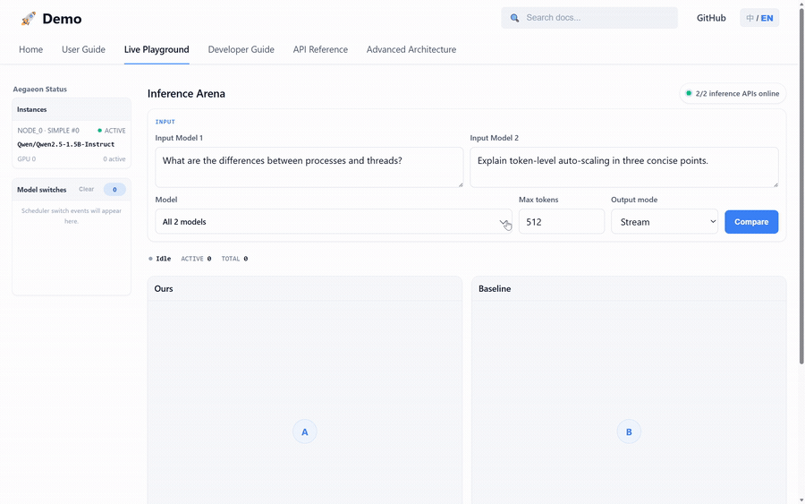

<p align="center">
  
</p>

<h1 align="center">Aegaeon</h1>

<p align="center">
  <strong>Efficient Model-as-a-Service, powered by token-level autoscaling.</strong>
</p>

<p align="center">
  <a href="https://doi.org/10.1145/3731569.3764815">Paper</a> ·
  <a href="https://asceticism-pku.github.io/aegaeon-preview/en/">Documentation</a>
</p>

## Why Aegaeon?

Aegaeon is a blazingly fast inference system for deploying multiple AI models on shared GPUs, enabling Model-as-a-Service (MaaS) both in local and cloud environments.

### Key Features

- **Token-level autoscaling** — switch models between token steps instead of waiting for whole requests to finish.
- **SLO-aware scheduling** — coordinates Prefill and Decode work against TTFT and TPOT objectives.
- **Fast model switching** — combines host-side weight caching, prefetching, a Rust quick loader, and explicit KV-cache movement.
- **Multi-model runtime** — supports dynamic model deployment, multiple replicas, and load-aware request routing.
- **vLLM backend** — inherits model and kernel support across dense, hybrid, and MoE architectures from vLLM.
- **Serving and observability** — provides OpenAI-style Chat and Completion APIs, SSE streaming, and runtime state telemetry.

See our [SOSP '25 paper](https://doi.org/10.1145/3731569.3764815) for more technical details.

### Demo

The following demo compares Aegaeon with a request-level baseline while both serve the same two models. It shows model switches, streamed outputs, and per-GPU power and energy measurements.

<p align="center">
  
</p>

## Quick Start

Run from the repository root on Linux x86_64 (glibc ≥2.31), with Conda initialized and a compatible NVIDIA driver. This example uses CPython 3.10 and CUDA 12.9.

**1. Install.** Prepare the CUDA/C++ toolchain and Ninja for runtime kernel compilation, then install the precompiled release. See [installation](docs/en/installation.md) for other CUDA routes and source builds.

Download the CPython 3.10, CUDA 12.9, Linux x86_64 wheel from [GitHub Releases](https://github.com/pkusys/aegaeon/releases) into the repository root. Keep only the selected Aegaeon wheel in that directory.

```bash
conda create --solver classic -n aegaeon python=3.10 -y
conda activate aegaeon
conda install --solver classic -c nvidia cuda-toolkit=12.9 \
  gcc_linux-64=11.2.0 gxx_linux-64=11.2.0 ninja -y
conda activate aegaeon
python -m pip install ./aegaeon-*.whl \
  --extra-index-url https://download.pytorch.org/whl/cu129 \
  --extra-index-url https://wheels.vllm.ai/0.26.0/cu129
```

**2. Prepare the model.** For an existing checkpoint, set `MODEL_DIR` to its absolute path and skip `hf download`. The example configuration and matching profiles are bundled.

```bash
MODEL_DIR="$HOME/aegaeon-models/Qwen3-4B"
hf download Qwen/Qwen3-4B --local-dir "$MODEL_DIR"
cp docs/en/examples/simple.yaml aegaeon.yaml
sed -i "s|/srv/models/Qwen3-4B|$MODEL_DIR|" aegaeon.yaml
```

**3. Start the service.** Select an available GPU; `--ray-address local` starts Ray automatically. Wait for `Application startup complete`.

```bash
export CUDA_HOME="$CONDA_PREFIX"
export LIBRARY_PATH="$CUDA_HOME/lib:$CUDA_HOME/lib64${LIBRARY_PATH:+:$LIBRARY_PATH}"
CUDA_VISIBLE_DEVICES=0 aegaeon start --config aegaeon.yaml \
  --host 127.0.0.1 --port 8000 --ray-address local
```

**4. Send a request.** In another terminal at the repository root:

```bash
curl -sS http://127.0.0.1:8000/v1/chat/completions \
  -H 'Content-Type: application/json' \
  --data-binary @docs/en/examples/chat-request.json
```

The response includes `choices[0].message.content` and token `usage`. For another GPU/model, adjust the configuration and profiles using the [full quickstart](docs/en/quickstart.md). Startup issues are covered in [troubleshooting](docs/en/troubleshooting.md).

DGX Spark deployments use CUDA 13.0 on Linux aarch64 and matching GB10 profiles; see [installation](docs/en/installation.md).

## Documentation

| Topic | Guide |
|---|---|
| Installation and first request | [Installation](https://asceticism-pku.github.io/aegaeon-preview/en/installation/) · [Quickstart](https://asceticism-pku.github.io/aegaeon-preview/en/quickstart/) |
| Supported models and limitations | [Features and Compatibility](https://asceticism-pku.github.io/aegaeon-preview/en/capabilities/) · [Model Preparation](https://asceticism-pku.github.io/aegaeon-preview/en/models/) |
| Deployment and model lifecycle | [Distributed Deployment](https://asceticism-pku.github.io/aegaeon-preview/en/deployment/) · [Model Management](https://asceticism-pku.github.io/aegaeon-preview/en/model-management/) |
| API usage | [Online Inference](https://asceticism-pku.github.io/aegaeon-preview/en/serving/) · [HTTP API](https://asceticism-pku.github.io/aegaeon-preview/en/api/) |
| Internals | [Architecture](docs/en/architecture.md) · [Scheduling and SLOs](docs/en/scheduling.md) |
