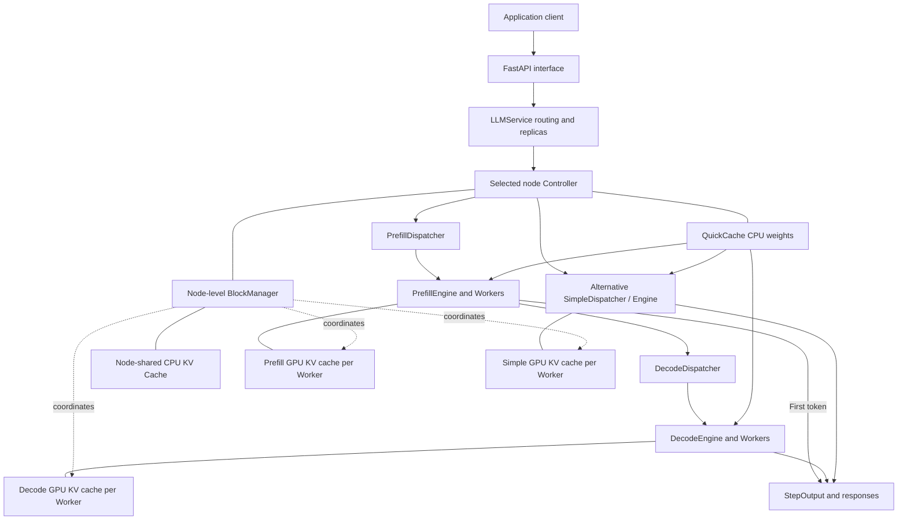

# System Architecture

Simple and P/D are alternative execution modes. Each configured node has one Controller and shared CPU caches. Several configured nodes can share a physical host. Workers have separate GPU KV caches, coordinated by their node's BlockManager.

## Components

- **API / LLMService:** request formatting, replica placement, and routing.
- **Controller / Schedulers:** node-local dispatch, batches, and model quotas.
- **StageEngine / Worker:** GPU execution using vLLM models and kernels.
- **QuickCache / QuickLoader:** shared CPU model weights and loading onto GPUs.
- **BlockManager:** request KV state and CPU/GPU transfers.

A request is routed to a node with a READY replica of its model. In P/D mode, Prefill produces the first token and unfinished requests continue on a Decode engine. In Simple mode, the same engine handles both phases. The node's CPU KV cache preserves request state across model switches. See [Scheduling](scheduling.md) and [Memory](memory.md) for details.
