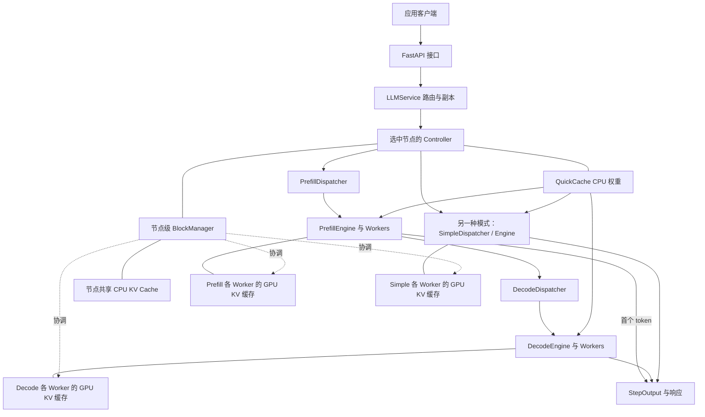

# 系统架构

Simple 与 P/D 是两种可选执行模式。配置中的每个节点都有一个 Controller 和共享 CPU 缓存；同一台物理机可以运行多个这样的节点。各 Worker 持有独立的 GPU KV 缓存，由所属节点的 BlockManager 协调。

## 组件

- **API / LLMService：** 请求格式处理、副本放置与路由。
- **Controller / Schedulers：** 节点内分发、batch 和模型配额调度。
- **StageEngine / Worker：** 使用 vLLM 模型与内核执行 GPU 计算。
- **QuickCache / QuickLoader：** 共享 CPU 模型权重，并将其加载到 GPU。
- **BlockManager：** 请求 KV 状态及 CPU/GPU 搬运。

请求被路由到模型副本处于 READY 状态的节点。P/D 模式下，Prefill 产生首个 token，未结束的请求继续由 Decode 引擎处理；Simple 模式下，同一个引擎处理两个阶段。节点的 CPU KV 缓存在模型切换期间保留请求状态。详见[调度](scheduling.md)和[内存管理](memory.md)。
